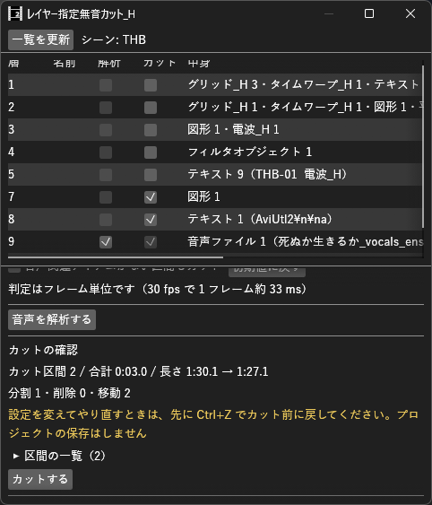

# レイヤー指定無音カット_H マニュアル

**レイヤー指定無音カット_H**（LayerSilenceCut_H）は、指定したレイヤーの音声だけで無音の区間を見つけ、指定したレイヤーだけをその区間で切って後ろを詰める、ジェットカットの汎用プラグインです。
文字起こしは必要なく、音の大きさだけで判定します。

- **バージョン:** 0.2.0
- **作者:** by HexBrowns
- **必要環境:** AviUtl2 **2.1.11** 以上
- **元にした機能:** YMM4プラグイン「レイヤー指定無音カット」。[解説記事](https://note.com/poweredokita/n/n857f02002aac)の機能説明を元にAviUtl2向けに作り直したもので、コードは使っていません

カットは **元に戻す** 1 回で取り消せます。
プロジェクトの保存やバックアップの作成はしません。

---

## 開き方

- **表示** メニュー → **レイヤー指定無音カット_H**

## 導入

1. [Releases](https://github.com/HexBrowns/LayerSilenceCut_H/releases) から `HexBrowns.LayerSilenceCut_H-v0.2.0.au2pkg.zip` をダウンロードし、AviUtl2のプレビューへドラッグ&ドロップする。
   手で置くなら、中の `Plugin` フォルダをデータフォルダ `C:\ProgramData\aviutl2` へコピーする。
2. AviUtl2を起動する。
3. **表示** メニュー → **レイヤー指定無音カット_H** でウィンドウを開く。

導入されるのは `Plugin\LayerSilenceCut_H\LayerSilenceCut_H.aux2` だけです。

---

## 使い方

1. **一覧を更新** を押す。表示中のシーンの、オブジェクトがあるレイヤーが並びます。
2. 声などのレイヤーの **解析** に✓を入れる。解析対象は自動で **カット** にも入ります。
3. 画面録画や字幕など、音声と一緒に切りたいレイヤーの **カット** に✓を入れる。BGMのように切りたくないレイヤーは何も入れない。
4. **音声を解析する** を押す。進み具合が出ます。**中止** で止められます。
5. **カットの確認** を見る。カット区間の数・合計時間・カット前後の長さ・分割／削除／移動の数・削除するオブジェクトの一覧が出ます。
6. **カットする** を押す。

設定の ① 〜 ④ を変えると、解析し直さずにカットの確認がその場で変わります。
レイヤーの選択を変えたときは解析し直してください。

### レイヤーの一覧

| 列 | 内容 |
|------|------|
| 層 | レイヤー番号。非表示・ロックのレイヤーには印が付きます |
| 名前 | レイヤー名 |
| 解析 | この層の音声だけで無音を判定します。音声関連のオブジェクトが無い層は選べません |
| カット | 無音の区間で切って詰める層 |
| 中身 | 種類ごとの件数と、最初の 1 件の名前 |

一覧を更新したときに、名称が変わったレイヤーや、オブジェクトが無くなったレイヤーの選択は外れます。

### 設定

| 項目 | 初期値 | 範囲 | 内容 |
|------|------|------|------|
| ① 無音判定基準 | -40 dB | -60〜0 dB | この音量以下を無音、これを超える音を有音とみなします。小さい声が切れるときは小さくします |
| ② 最短無音時間 | 500 ms | 100〜5000 ms | これより短い無音は切らずに残します |
| ③ 最短有音時間 | 100 ms | 0〜500 ms | 前後が最短無音時間以上の無音に挟まれた、これより短い音を無音とみなします。0 で無効 |
| ④ 有音区間拡張 | 100 ms | 0〜1000 ms | 有音の前後に残す無音の長さ。話し始め・話し終わりが切れるときは長くします |
| 音声関連アイテムがない区間もカット | オフ | — | オンにすると、解析対象の層に音声関連のオブジェクトが無い区間も切ります |

- 数値の欄は、Enterかほかをクリックしたときに確定します。入力中にEscを押すと、入力する前の値に戻ります。ドラッグで変えたときは、カットの確認がその場で変わります
- 判定はフレーム単位です。ms はフレーム数に四捨五入します
- 設定は `Plugin\LayerSilenceCut_H\settings.json` に保存され、次回も引き継がれます。**初期値に戻す** で戻せます
- 設定ファイルが読めなかったときは、`settings.json.broken-（数字）` に名前を変えて残し、初期値で始めます
- 項目名にマウスを乗せると説明が出ます

### 下の欄の高さ

設定・解析・確認の欄はスクロールできます。上の一覧との境目をドラッグすると、高さを変えられます。

---

## 判定のしかた

- 判定に使う音は、再生位置・再生速度・再生範囲・ループ・フィルタ効果を反映した、本体が実際に鳴らす音です。オブジェクトの **音量** も掛けて判定します
- 1 フレームごとの音の大きさを dB にして、① と比べます
- 音声関連のオブジェクト: 音声ファイル、**音声付き** をオンにした動画ファイル、音を出すほかのオブジェクト
- 解析対象のレイヤーが**非表示**なら、そのレイヤーのオブジェクトは全体を無音とみなします
- 解析対象が複数あるときは、**全部が無音の時間だけ**切ります。1 つでも有音なら残します
- シーンの頭と終わりの無音は、④ の分を残さずに切ります

## カットのしかた

- カット区間をまたぐオブジェクトは、その位置で分割します。カット区間に完全に収まるオブジェクトは削除します
- 分割したオブジェクトの各フレームの見た目は、切る前と同じです。中間点や移動も、残った部分がそのまま続きます
  - 音声・動画の再生位置は、本体の「分割」と同じように調整します
  - 加速・減速・イージングの区間を途中で切ると、その区間の動きの形は変わります
  - ランダム移動は、乱数の並びが切る前と変わります
  - **中間点無視** の項目と **区間ごとのチェックボックス** は、本体の「分割」と結果が違います。本体は値をそのまま写し、こちらは各フレームの見た目を保ちます
- ロックされたレイヤーも切ります。確認画面に出ます
- グループ制御・カメラ制御のオブジェクトも範囲だけを切ります。確認画面に注意が出ます。下のレイヤーへの効き方が変わることがあります
- **カットする** を押すと、何かを変える前に、動かす先・分割して作り直す先がほかのオブジェクトでふさがっていないかを全部のレイヤーで確かめます。ふさがっていれば何も変えずに、どのレイヤーのどの範囲が置けないかを知らせます
- 確かめた後で万一途中で作れなかったときは、そこで止めて、どこが作れなかったかとCtrl+Zの案内を出します

---

## 注意事項・制限

- 設定を変えてやり直すときは、**先にCtrl+Zでカット前に戻してから** 解析し直してください
- 解析した後にタイムラインが変わったときは、カットせずに知らせます。解析し直してください
- 再生中・ファイル出力中は解析もカットもできません
- 解析の途中でAviUtl2を終了しても大丈夫です
- 対象は**表示中のシーン**だけです
- 重要なプロジェクトは、試す前にコピーを取っておいてください
